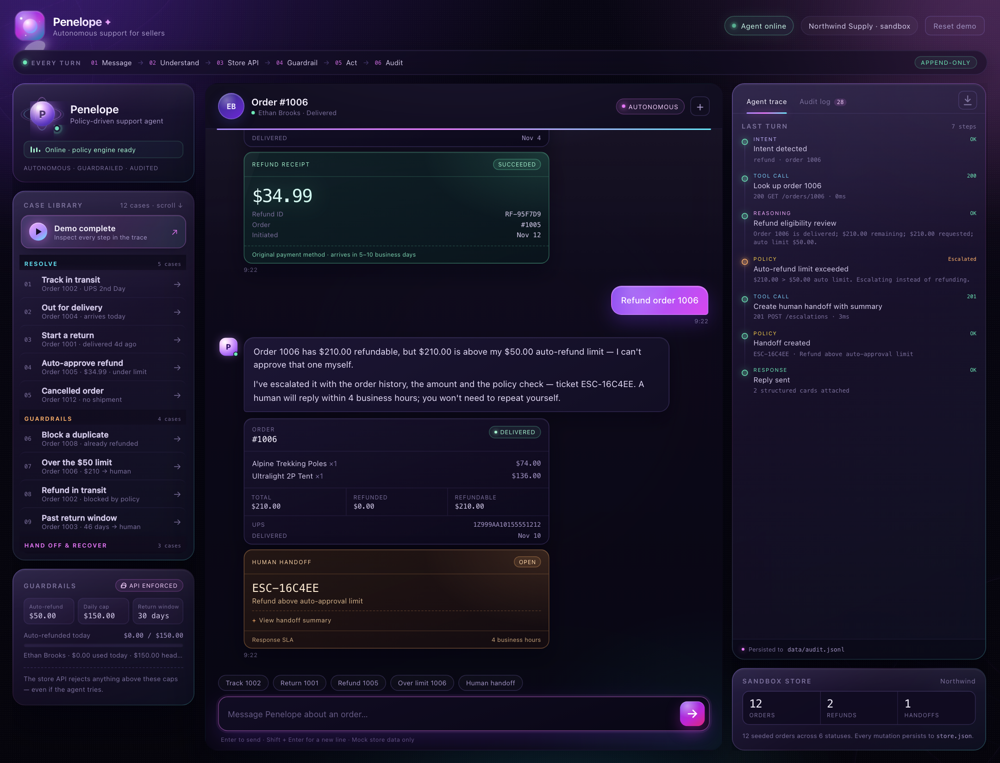

# Penelope

Penelope is an autonomous customer-support agent for small e-commerce sellers. It handles "where is my order", returns, refunds and human handoffs over a WhatsApp-style chat — with real tool calls against mock store APIs, server-enforced refund guardrails, and an append-only audit log of every action.



**No API key, no dependencies, no build step.** Node 20+ only.

```bash
npm start
# → http://localhost:4173
```

```bash
npm test
# 18 tests: agent flows + guardrail enforcement
```

---

## What it does

| Customer asks | Agent behavior |
|---|---|
| "Where is my order 1002?" | Looks up the order, calls the shipment API, returns last scan, carrier, tracking and ETA. |
| "Where is order 1007?" | Notices the shipment has not moved for 12 days (policy threshold: 10), **auto-escalates as a likely lost parcel**, and gives the customer a ticket. |
| "I want to return order 1001" | Checks delivery date and the 30-day window, then creates an RMA via the returns API and explains drop-off and refund estimate. |
| "Return order 1003" | Delivered 46 days ago. Blocks the return, **auto-escalates an out-of-window exception** with a summary. |
| "Please refund order 1005" | $34.99 is under the $50 auto limit and inside the daily cap. Issues the refund via the refunds API and returns a receipt card. |
| "Refund order 1006" | $210 exceeds the $50 auto limit. **Issues no refund**, creates a human handoff with the amount, order history and policy check. |
| "Refund order 1008" | Already fully refunded. Blocks the duplicate and shows the existing refund. |
| "I need a human" | Creates a handoff ticket containing customer, order, shipment, checks performed, policy outcome, recommendation and conversation transcript. |
| "I need a refund" then "1005" | Remembers the pending intent, asks for the order number, then completes the refund. |

Every turn drives the same loop: **understand → fetch data over HTTP → evaluate policy → act or escalate → log**.

---

## Why it fits the brief

- **Real tool/API calls on mock store data.** The agent has no direct access to the store object. Each tool (`lookup_order`, `track_shipment`, `get_refund_usage`, `start_return`, `issue_refund`, `create_escalation`) makes an HTTP request to the mock store API (`/api/store/*`). The store is seeded with 12 orders and persisted to `data/store.json`.
- **Refund-limit guardrails.** Enforced twice: the agent checks policy before acting, and the store API independently rejects anything outside policy. A direct API call bypassing the agent still fails.
- **A log of every action.** Append-only JSONL at `data/audit.jsonl`: customer messages, detected intents, every tool call and result, policy decisions, store mutations, agent replies and errors. One click downloads the full log.
- **Autonomous escalation.** Beyond "talk to a human", the agent proactively escalates stale shipments, lost parcels, out-of-window returns and refunds above its authority — each with a structured summary.

---

## Guardrails

| Rule | Limit | Enforced by | Error code |
|---|---|---|---|
| Per-refund auto approval | $50.00 | Agent pre-check + store API | `REFUND_LIMIT_EXCEEDED` |
| Daily auto-refund cap | $150.00 / customer / UTC day | Store API (sums today's refunds) | `DAILY_LIMIT_EXCEEDED` |
| Return window | 30 days from delivery | Store API + agent | `RETURN_WINDOW_EXPIRED` |
| Refundable status | Delivered or returned only | Store API + agent | `NOT_REFUNDABLE` |
| Refund ≤ remaining balance | Order total − refunded | Store API | `EXCEEDS_ORDER_TOTAL` |
| Duplicate refund | One full refund per order | Store API | `ALREADY_REFUNDED` |
| Idempotency | Same key = no double spend | Store API | returns existing refund |
| Stale shipment escalation | No scans for 10 days | Agent | auto handoff |
| Return before delivery | Blocked | Store API | `NOT_DELIVERED` |
| Duplicate return | Blocked | Store API | `RETURN_EXISTS` |

The policy lives in [`lib/policy.js`](lib/policy.js); enforcement lives in [`lib/store.js`](lib/store.js).

---

## Demo script (60–90 seconds)

**Fastest path:** click **Run the 3-turn demo** at the top of the case library. Penelope tracks order 1002, auto-approves $34.99 on order 1005, then trips the $50 guardrail on order 1006 and hands off — all in one conversation, with the trace left open.

Then walk the library, grouped by job:

1. **Resolve** — Track in transit (1002), Out for delivery (1004), Start a return (1001), Auto-approve refund (1005), Cancelled order (1012).
2. **Guardrails** — Block a duplicate (1008), Over the $50 limit (1006), Refund in transit (1002), Past return window (1003).
3. **Hand off & recover** — Stale parcel (1007), Find by email (`maya.chen@example.com`), Human handoff with a structured summary.

Each click runs a real conversation. Point out the **Agent trace** updating on the right, then switch to the **Audit log** tab or download the JSONL — every tool call, policy decision and store mutation is there, including server-side guardrail blocks.

Also try "I need a refund" followed by "1005" to show pending-intent memory.

**Reset demo** in the top-right clears store mutations, sessions and the audit log.

---

## Architecture

```text
Browser (vanilla JS chat UI)
        │  POST /api/chat
        ▼
Agent policy engine  ──────────────┐
  intent + order resolution        │ structured trace
  tool loop over HTTP              │ + cards
        │                          │
        ▼                          │
Mock store REST API  ◄─────────────┘
  /api/store/orders               │
  /api/store/shipments            │
  /api/store/returns              ▼
  /api/store/refunds        data/audit.jsonl  (append-only)
  /api/store/escalations    data/store.json   (persisted mock data)
```

| File | Responsibility |
|---|---|
| [`server.js`](server.js) | Zero-dependency HTTP server, static files, chat/session routing, store API, log download, reset. |
| [`lib/agent.js`](lib/agent.js) | Intent detection, order resolution, conversational state, tool-call loop, policy checks, cards, handoff summaries. |
| [`lib/store.js`](lib/store.js) | Mock store state, serialization, returns/refunds/escalations, guardrail enforcement, persistence. |
| [`lib/policy.js`](lib/policy.js) | Policy constants and money/date/refund-usage helpers. |
| [`lib/seed.js`](lib/seed.js) | 12 seeded orders, shipments, returns and refunds with relative dates. |
| [`lib/audit.js`](lib/audit.js) | Append-only JSONL writer/reader. |
| [`public/`](public/) | Chat UI, live agent trace, audit log, guardrail usage. |

No framework, no runtime dependencies. The frontend is DOM-API only and never injects untrusted HTML.

---

## Mock store

The store is generated relative to the current date so return windows, ETAs and stale-shipment checks stay meaningful. Orders 1001–1012 include:

| Order | State | Purpose |
|---|---|---|
| 1001 | Delivered 4 days ago, $147.00 | Eligible return |
| 1002 | In transit, $98.00 | WISMO / tracking |
| 1003 | Delivered 46 days ago, $240.00 | Return-window exception |
| 1004 | Out for delivery, $89.00 | Mid-shipment refund block |
| 1005 | Delivered 8 days ago, $34.99 | Auto refund |
| 1006 | Delivered 2 days ago, $210.00 | Refund limit escalation |
| 1007 | In transit, no scans for 12 days, $58.00 | Stale/lost auto-escalation |
| 1008 | Delivered, already refunded $45.00 | Duplicate block |
| 1009 | Processing, $40.00 | Pre-dispatch refund block |
| 1010 | Delivered 22 days ago, $150.00 | High-value refund |
| 1011 | Returned (RMA received), $75.00 | Return + refund context |
| 1012 | Cancelled, $29.00 | No-shipment state |

Store data persists in `data/store.json`. Delete it or use **Reset demo** to reseed.

---

## API

### Public app API

| Method | Route | Behavior |
|---|---|---|
| `POST` | `/api/chat` | Run one agent turn. Body: `{ message, sessionId? }`. Returns reply, cards, trace, guardrails usage, stats. |
| `GET` | `/api/policy` | Policy limits and store stats. |
| `GET` | `/api/logs?sessionId=&limit=` | Audit entries (optionally session-filtered). |
| `GET` | `/api/logs/download` | Download full audit log as `.jsonl`. |
| `POST` | `/api/reset` | Reseed store, clear sessions and audit log. |
| `GET` | `/api/health` | Health and counts. |

### Mock store API (the agent's tools)

| Method | Route | Purpose |
|---|---|---|
| `GET` | `/api/store/orders/:id` | Order + return/refund history |
| `GET` | `/api/store/orders?email=&q=` | Find orders |
| `GET` | `/api/store/shipments/:tracking` | Shipment events + ETA |
| `GET` | `/api/store/customers/:id/refund-usage` | Daily auto-refund usage and headroom |
| `POST` | `/api/store/returns` | Create RMA |
| `POST` | `/api/store/refunds` | Issue auto refund (guardrails enforced) |
| `POST` | `/api/store/escalations` | Create human handoff |
| `GET` | `/api/store/escalations` | Handoff queue |

Example rejected refund (this is the guardrail, not the agent, saying no):

```bash
curl -s -X POST http://localhost:4173/api/store/refunds \
  -H 'content-type: application/json' \
  -d '{"orderId":"1006","amountCents":21000}'

# 409
{"ok":false,"error":{"code":"REFUND_LIMIT_EXCEEDED",
 "message":"Refund of $210.00 exceeds the $50.00 automatic refund limit and requires human approval."}}
```

---

## Audit log

Each line is a self-contained JSON event:

```json
{
  "id": "evt_4f8a1c2d",
  "ts": "2026-11-12T08:57:11.204Z",
  "sessionId": "sess_4a91cd20",
  "actor": "agent",
  "type": "tool_result",
  "status": "ok",
  "summary": "Issue $34.99 refund: 201 POST /refunds · 2ms",
  "tool": "issue_refund",
  "data": { "httpStatus": 201, "durationMs": 2, "response": { "ok": true } }
}
```

Event types include `customer_message`, `intent_detected`, `tool_call`, `tool_result`, `policy_decision`, `agent_reply`, `store.refund_issued`, `store.return_created`, `store.escalation_created`, and `agent_error`. The UI's Audit tab filters to the current session; the download contains everything.

---

## Tests

```bash
npm test
```

- `test/integration.test.js` — starts the real server on an ephemeral port and exercises WISMO, returns, auto refunds, duplicate blocking, over-limit escalation, stale shipment and out-of-window auto-escalation, human handoff summaries, pending-intent continuity, and audit contents.
- `test/guardrails.test.js` — unit-tests the store API guardrails directly: per-refund limit, daily cap, idempotency, duplicate refunds, non-refundable states, return window, pre-delivery returns, invalid amounts and 404s.

All 18 tests pass.

---

## Production notes

This is a local demo with mock data and no authentication. The UI is a seller-side sandbox, so it can inspect any seeded order. Before production: bind sessions to an authenticated customer, add rate limiting and retries around tool calls, replace the deterministic intent router with an LLM planner that uses the same tools, move the store to a real database and the audit log to append-only object storage, and route handoffs into the seller's helpdesk.
